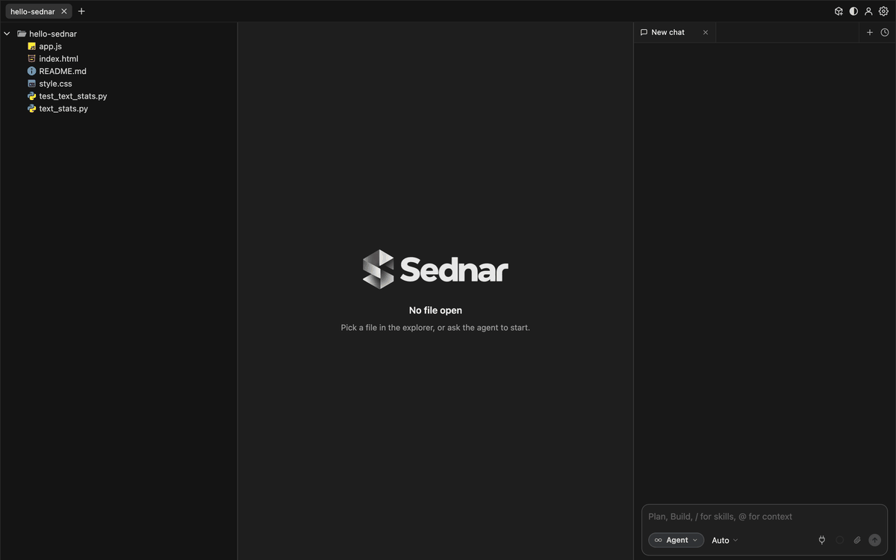
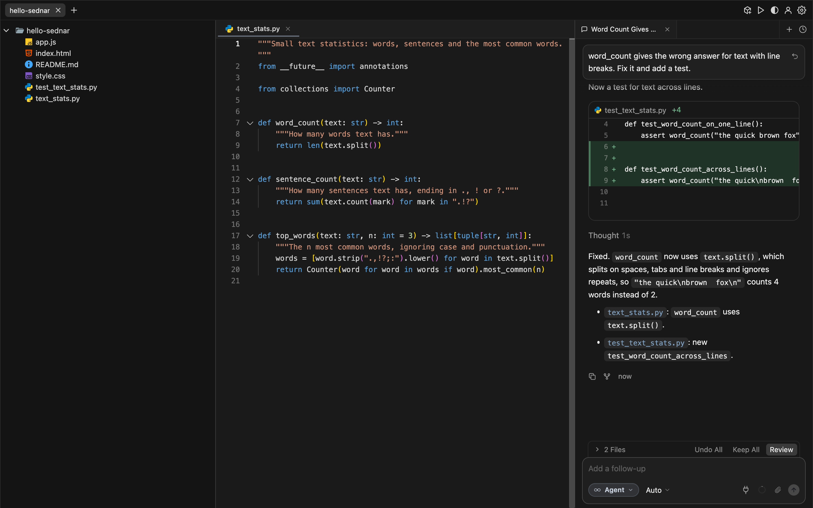
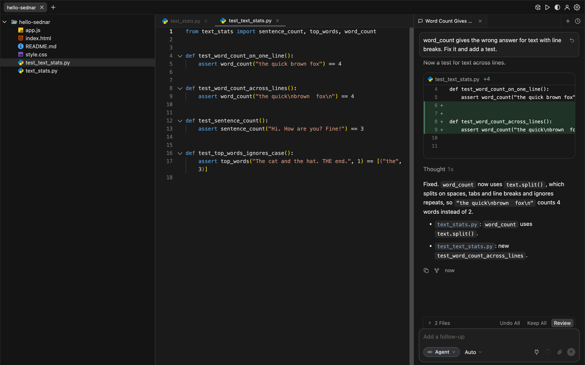
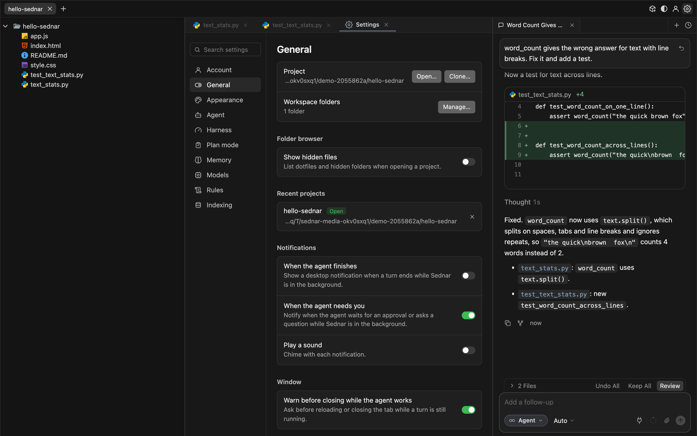
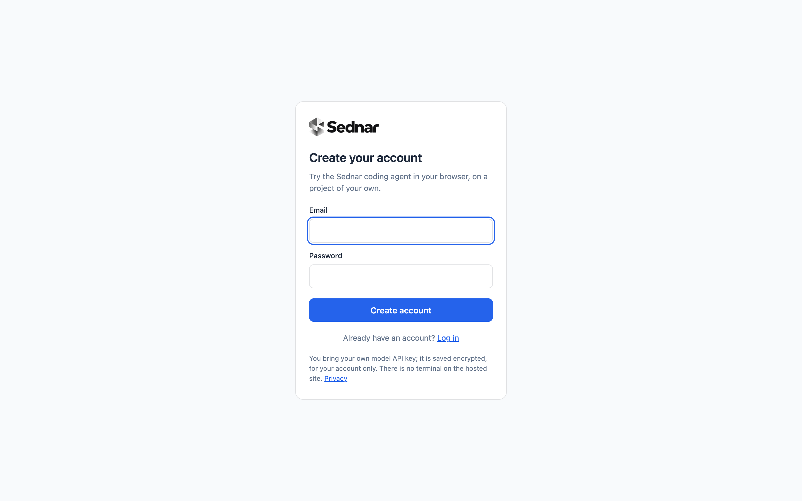

<p align="center">
  <picture>
    <source media="(prefers-color-scheme: dark)" srcset="static/assets/sednar/sednar-logo-white.png">
    
  </picture>
</p>

<p align="center">
  An AI coding agent with an editor, in your browser.<br>
  Sign up at <a href="https://sednar.com">sednar.com</a> and bring your own API key for Gemini, OpenAI, Anthropic, xAI, Mistral, Groq or OpenRouter.
</p>

<p align="center">
  <a href="https://sednar.com"></a>
</p>

---

Sednar is an editor, a terminal and a coding agent in one window. You can use it at [sednar.com](https://sednar.com), described in [Host a public demo](#host-a-public-demo), or run it on your own machine as the rest of this README explains.

## Screenshots

| The agent at work | The editor |
| --- | --- |
|  |  |
| **Settings** | **Sign in at sednar.com** |
|  |  |

The demo and screenshots are made with `python3 sednar/docs/media/capture.py`, run from the folder above the repository. It runs Sednar locally against a scripted model, so it needs no API key; the edits are real.

## Features

- **Coding agent** that reads, searches and edits your project, runs commands, and verifies its changes. It has three modes: **Agent** (makes changes), **Plan** (writes a plan for you to approve) and **Ask** (answers without editing).
- **Any provider, one key each.** Add keys in Settings → Models and choose the default provider. **Auto** picks a model for each step:
  - requests with images go to a model that can read them;
  - code changes can go to a code model;
  - hard and quick tasks get different tiers.

  Text-only models still get images: another model describes them in text first.
- **Questions in the chat.** When something is really open, the agent asks in the questions card, in any mode: options for a choice (one or several), or a text box for an open answer. The answer continues the same turn.
- **Editor and terminal.** A Monaco editor with Python and TypeScript intelligence, an integrated terminal, and background commands for dev servers and watchers.
- **Review and undo.** Pending changes show as diffs, and you can roll back to a checkpoint.
- **Project context.** The agent reads project rules (`AGENTS.md`, `CLAUDE.md`, `.claude/rules/*.md`), keeps a searchable project memory, and connects to MCP servers.
- **Chats as you saw them.** Each chat is saved as its rendered transcript, so opening it again shows it exactly.
- **Themes:** Dark, Light, Black and Pink, or follow your system's light and dark mode.

## Requirements

- Python **3.10 or newer**
- An API key from at least one supported provider
- macOS or Linux (the terminal uses a PTY)

## Install

### From source

```bash
git clone https://github.com/amarkum/sednar.git
cd sednar
python3 -m venv .venv
source .venv/bin/activate
pip install -r requirements.txt
```

> The folder must be named `sednar`, because the package imports itself by that name. `git clone` creates it with that name.

## Run

```bash
python3 server.py
```

Open **http://localhost:9000**, then:

1. Open a project folder, or clone or create a new one.
2. Go to **Settings → Models**, add an API key and make that provider the default.
3. Start chatting in the agent panel.

To use a different port, set `SEDNAR_PORT`:

```bash
SEDNAR_PORT=9001 python3 server.py
```

## Configuration

Most settings are in the app, under **Settings**, with a search box at the top:

- **General**: projects, notifications, settings backup and restore.
- **Appearance**: theme (or follow the system), conversation text size, editor font and behaviour.
- **Agent**: default mode, approvals, web tools, custom instructions for every chat.
- **Harness**: step limits, subagents, parallel tool calls, loop guard, model retries, command timeout, compaction threshold.
- **Plan mode**: plan detail, clarifying questions, diagrams, tests section, recent plans.
- **Memory**: recall and saving options, plus MEMORY.md, session logs, consolidation and clearing for the open project.
- **Terminal**: font size, cursor, blinking and scrollback.
- **Languages**: language servers for Python, TypeScript/JavaScript, Java, Kotlin, Scala, Go, Rust, C/C++, C#, Swift, Ruby, PHP, Dart, Lua, Elixir, Haskell, Zig, Shell, YAML, Terraform, Dockerfile, SQL, HTML, CSS, JSON and Markdown. Installed servers are found automatically; each language can be turned off or given its own command. They power editor completions, hover, go to definition, rename and live errors, and the agent's `lsp_*` tools.
- **Models**, **Rules**, **MCP**, **Indexing**.

They are saved on your machine:

| File | Holds |
| --- | --- |
| `~/.sednar/settings.json` | Editor, terminal, agent and panel-size settings |
| `~/.sednar/llm.json` | API keys (saved with `0600` permissions), the default provider, Auto options |
| `~/.sednar/agent.json` | Harness, memory and plan-mode settings (only values that differ from the defaults) |
| `llm/models.yaml` | Provider catalog: which models each provider offers, and whether each model reads images or is tuned for code. Sednar reloads this file when it changes. |

Useful environment variables:

| Variable | Purpose |
| --- | --- |
| `SEDNAR_PORT` | Server port (default `9000`) |
| `SEDNAR_LOG_LEVEL` | Log level (default `INFO`) |

### Adding a model or provider

Edit `llm/models.yaml`. A provider either finds the newest models the key can use (`discover:`) or lists a fixed set (`models:`). Each model can be marked:

- `fast: true`: Auto uses it for quick tasks.
- `vision: false`: it cannot read images.
- `code: true`: Auto prefers it for code changes.

The comments at the top of the file explain each option.

## Optional extras

These are included in `requirements.txt`, and Sednar works without them:

| Package | Enables |
| --- | --- |
| `flask-sock` | The Python language server in the editor |
| `python-lsp-server` | Python completions, hovers and diagnostics |
| `mcp` | Connecting to MCP servers |
| `jsonschema` | Validation of tool arguments |

## Project layout

| Path | Role |
| --- | --- |
| `server.py` | Entry point: Flask and Socket.IO app |
| `routes.py`, `lsp_routes.py` | HTTP, Socket.IO and language server routes |
| `harness.py` | Agent turn loop, model routing, tool execution |
| `llm/` | Provider clients, router, settings and model catalog |
| `tools.py`, `search_replace.py` | Repository tools: read, search, edit, commands |
| `memory/`, `compaction/` | Project memory and context compaction |
| `static/`, `templates/` | Frontend: editor, agent panel, settings |

## Host a public demo

This is how sednar.com runs.

This repository also runs as the hosted site at sednar.com, where people sign up, log in and use it in their own browser with their own API key:

```bash
docker build -t sednar-public .
docker run --rm -p 9000:9000 -v sednar-data:/data -e SEDNAR_SECRET_KEY=change-me sednar-public
```

To put it online, deploy `render.yaml` as a Render Blueprint, or run the image on any host that runs Docker. You need:

- **One instance.** Logins are held in that process's memory.
- **A persistent disk at `/data`.** Accounts, projects and chats are stored there.
- **`SEDNAR_SECRET_KEY`.** It signs the login cookie.

The image serves the site with gunicorn (`gunicorn.conf.py`: one process, many threads). Requests for any other address, such as www.sednar.com or the onrender.com one, redirect to `SEDNAR_PUBLIC_URL`. Pages carry security headers (HSTS over HTTPS, no framing, `nosniff`), and `/privacy` says what is stored.

Public mode (`SEDNAR_PUBLIC=1`, in `public_mode.py` and `public_accounts.py`) changes this:

- People sign up with an email and a password, or with GitHub. Passwords are stored as scrypt hashes, and logins are rate limited. People who sign in with GitHub can open any of their repositories from Settings > Account: it is cloned into their folder and opened in the editor. Each account gets a folder of its own with the sample project from `public/sample-project/`. Settings > Account (the user icon in the top bar) shows who is signed in, changes the password, logs out, or deletes the account with everything in it.
- API keys are saved encrypted (AES-GCM). For a password account the key comes from the password, so the server can read them only while that user is logged in. A GitHub account has no password, so its key comes from `SEDNAR_PUBLIC_DATA_KEY` (or `SEDNAR_SECRET_KEY`) and the user's salt. A restart logs everyone out. Agent settings and preferences are saved in the user's folder.
- Anything that runs programs on the server is off: the terminal, `run_command` and background commands, MCP servers and language servers. The agent can still read, search, edit, plan and look things up on the web.
- Every path in a request or socket event must stay inside the user's folder. Git runs with settings a repository cannot override, nothing may write inside `.git`, and cloning takes public `https://` repositories only (one commit deep, 200 MB at most).

| Variable | Purpose |
| --- | --- |
| `SEDNAR_PUBLIC` | `1` turns public mode on (the Dockerfile sets it) |
| `SEDNAR_PUBLIC_BRAND` | The site's name in page titles and on the sign-in pages (default `Sednar`) |
| `SEDNAR_PUBLIC_SOURCE_URL` | Where people can get the code; shows a "Run it yourself" link when set |
| `SEDNAR_SECRET_KEY` | Signs the login cookie; set it, or logins end on every restart |
| `SEDNAR_PUBLIC_ROOT` | Where user folders go (the image uses `/data/users`) |
| `SEDNAR_PUBLIC_DB` | The accounts database (default `accounts.sqlite3` in `SEDNAR_PUBLIC_ROOT`) |
| `SEDNAR_PUBLIC_MAX_USERS` | Accounts the site takes before sign-up closes (default `500`) |
| `SEDNAR_PUBLIC_SESSION_DAYS` | How long a login lasts (default `30`) |
| `SEDNAR_GITHUB_CLIENT_ID`, `SEDNAR_GITHUB_CLIENT_SECRET` | A GitHub OAuth app (callback URL `<site>/auth/github/callback`); turns on "Continue with GitHub" |
| `SEDNAR_GITHUB_PRIVATE_REPOS` | `1` asks GitHub for private repositories too (the `repo` scope); public ones need nothing |
| `SEDNAR_PUBLIC_DATA_KEY` | Encrypts GitHub accounts' saved keys (default: `SEDNAR_SECRET_KEY`); keep it, or they are lost |
| `SEDNAR_PUBLIC_URL` | The site's address, if GitHub's callback should not be built from the request |
| `SEDNAR_PUBLIC_SECURE_COOKIE` | `1` when the site is served over HTTPS (the cookie becomes `__Host-sednar`) |
| `SEDNAR_PUBLIC_QUOTA_MB` | How much a user's folder may hold before writes are refused (default `500`) |
| `SEDNAR_PUBLIC_MAX_TURNS` | Chats one user may have working at once (default `2`) |
| `SEDNAR_PUBLIC_CONTACT` | A contact line for the privacy page |
| `SEDNAR_THREADS` | gunicorn threads; each open page and each running turn holds one (default `64`) |
| `SEDNAR_PUBLIC_ORIGINS` | Comma-separated origins allowed to open the socket, if not the site's own |
| `PORT` | The port to listen on, as hosting platforms set it |

Users share one process and one system user, so this is not as strong as a container per user. While someone is logged in, whoever runs the server could read their keys from its memory. Sign-up does not verify email addresses.

## Contributing

Issues and pull requests are welcome. Please keep changes focused, match the surrounding style, and describe how you tested them.

To run the tests:

```bash
pip install pytest
python -m pytest tests
```

The agent-turn tests drive the real harness with a scripted model, so they need no API key.
